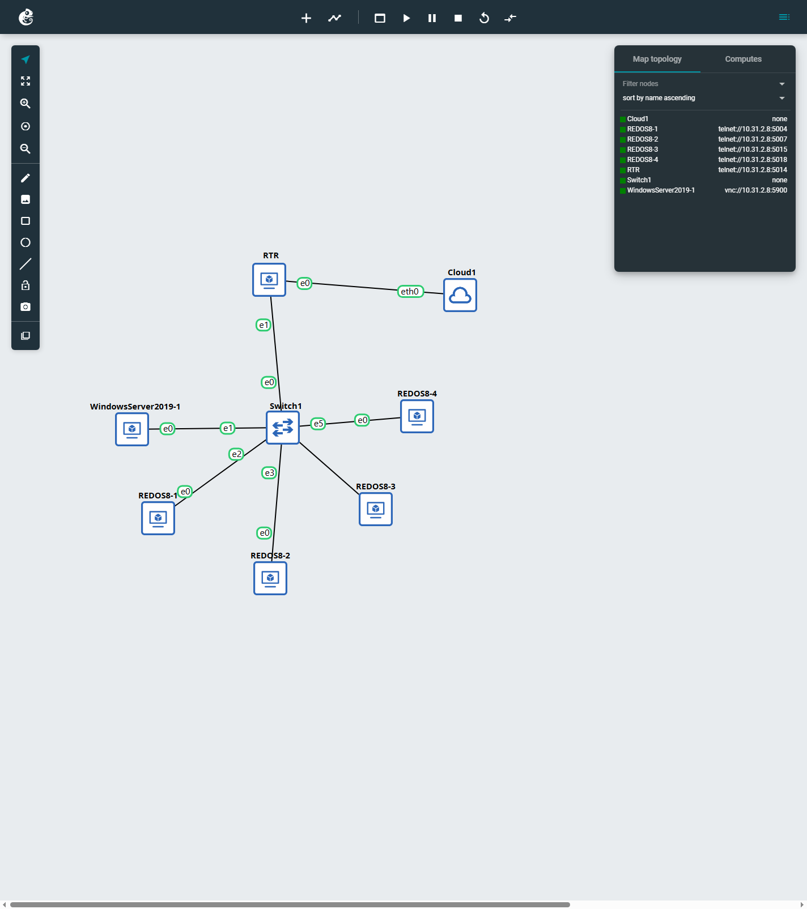

# SMART-HOME — система мониторинга умного офиса

Учебный проект по ПМ03 «Участие в разработке приложений взаимодействия с интеллектуальными
интегрированными системами» (специальность 09.02.08, группа 54-15, номер в журнале — **15**).

Виртуальный стенд «умного офиса» в GNS3: датчики температуры и влажности, автоматическое
управление вентилятором, хранение истории в SQLite, мониторинг в Prometheus/Grafana и оповещения
на электронную почту.

---

## Содержание

- [1. О проекте](#1-о-проекте)
- [2. Состав стенда](#2-состав-стенда)
- [3. Схема сети](#3-схема-сети)
- [4. Поток данных](#4-поток-данных)
- [5. Структура репозитория](#5-структура-репозитория)
- [6. Требования](#6-требования)
- [7. Развёртывание с нуля](#7-развёртывание-с-нуля)
- [8. Запуск после перезагрузки](#8-запуск-после-перезагрузки)
- [9. Проверка работоспособности](#9-проверка-работоспособности)
- [10. Работа с системой](#10-работа-с-системой)
- [11. Оповещения](#11-оповещения)
- [12. Испытания](#12-испытания)
- [13. Документация](#13-документация)
- [14. Устранение неполадок](#14-устранение-неполадок)
- [15. Безопасность](#15-безопасность)
- [16. Авторы](#16-авторы)

---

## 1. О проекте

Система контролирует микроклимат офиса и автоматически управляет вентиляцией:

- **TEMP-01** — температура в серверной (зона `server_room`, °C);
- **HUM-01** — относительная влажность в рабочей зоне (зона `work_area`, %);
- **FAN-01** — вентилятор: включается при температуре **больше 30 °C**, иначе выключается
  (режим `auto`).

Датчики формируются в Node-RED и отправляют показания **каждые 5 секунд** на приёмник CTRL-01
и в хранилище DB-01. Prometheus собирает метрики приёмника, Grafana строит панель и формирует
оповещения, если датчик или приёмник перестают отвечать.

Проект охватывает работы №3–8:

| Работа | Содержание |
|--------|------------|
| №3 | Установка Docker/Docker Compose, SSH и SCP между ВМ, Nginx на CTRL-01 |
| №4 | Приёмник показаний и виртуальные датчики в Node-RED |
| №5 | Эмуляция вентилятора FAN-01 по температуре |
| №6 | Интеграция SQLite на DB-01, веб-интерфейс истории |
| №7 | Prometheus и Grafana на MON-01, панель и правила оповещения |
| №8 | Подготовка к защите: документация, журнал испытаний, инструкция заказчику |

---

## 2. Состав стенда

| Устройство | IP-адрес | ОС | Роль | Сервисы и порты |
|------------|----------|----|------|-----------------|
| WIN-01 | 192.168.10.10 | Windows Server 2019 | рабочее место администратора | браузер |
| CTRL-01 | 192.168.20.10 | РЕД ОС 8 | управляющий узел, приёмник показаний | `receiver.js` в Docker, **8080** |
| MON-01 | 192.168.20.11 | РЕД ОС 8 | мониторинг | Prometheus **9090**, Grafana **3000** |
| DB-01 | 192.168.20.12 | РЕД ОС 8 | хранение истории | сервис хранения, SQLite, **8081** |
| IOT-01 | 192.168.30.10 | РЕД ОС 8 | узел IoT | Node-RED в Docker, **1880** |
| RTR | 192.168.10.1 / 20.1 / 30.1 | РЕД ОС 8 | маршрутизация между VLAN, NAT | — |
| SW | — | коммутатор GNS3 | VLAN 10 / 20 / 30 / 99 | — |

Внешний интерфейс RTR получает адрес по DHCP в сети GNS3.

---

## 3. Схема сети



Логическая схема в draw.io — [docs/topology.drawio](docs/topology.drawio), таблицы адресации —
[docs/addressing.docx](docs/addressing.docx).

---

## 4. Поток данных

```text
Node-RED (IOT-01:1880)
  ├─ POST /api/readings   → CTRL-01:8080  (журнал показаний)
  ├─ POST /api/actuators  → CTRL-01:8080  (команды FAN-01)
  ├─ POST /api/readings   → DB-01:8081    (SQLite, history)
  └─ POST /api/actuators  → DB-01:8081    (SQLite, actuator_events)

Prometheus (MON-01:9090) ── GET /metrics ──► CTRL-01:8080
Grafana   (MON-01:3000)  ── datasource prometheus-office ──► Prometheus
                         └─ правила TEMP-01 / HUM-01 / CTRL-01 ──► Email
```

---

## 5. Структура репозитория

```text
Practice-15/
├── README.md                  этот файл
├── journal.md                 журнал выполненных работ
├── КАК_ЗАПУСТИТЬ_СТЕНД.md     пошаговый запуск после перезагрузки
├── Инструкция заказчику v2.pdf  подробная инструкция для заказчика
├── receiver.js                приёмник показаний v3 (копия для удобства)
├── dashboard.json             панель Grafana (копия для удобства)
├── compose.yaml, compose.yml  учебные compose-файлы работы №3
└── docs/
    ├── topology.drawio        логическая схема сети
    ├── topology.png           схема стенда (снимок GNS3)
    ├── addressing.docx        таблицы адресации и портов
    ├── office_plan.plan       план помещения (remplanner)
    ├── GNS.docx               описание проекта GNS3
    ├── prometheus.yml         конфигурация Prometheus (job office-controller)
    ├── prometheus.service     systemd-юнит Prometheus
    ├── screen work №3/        скриншоты работы №3
    ├── screen work №4/        скриншоты работы №4
    ├── screen work №5/        скриншоты работы №5
    ├── screen & file №6/
    │   ├── file/              server.py, index.html, inspect_db.py, compose.yml
    │   └── screen/            скриншоты работы №6
    ├── screens & file work №7/
    │   ├── file/              prometheus.yml, prometheus.service, datasource.yml,
    │   │                      dashboard.json, alert-rules.md, alert-rules.yml,
    │   │                      contactpoints.yml, policies.yml, flow-fan-mon.json,
    │   │                      receiver-v3.js, экспорт правил и контактов
    │   └── screens/           панель, Prometheus UP, Alerting, Node-RED
    └── screens & file work №8/
        ├── file/              журнал работ и испытаний, протокол испытаний,
        │                      снимок состояния, экспорт правил
        ├── screens/           снимки стенда и подтверждение писем
        └── ...
```

---

## 6. Требования

- **GNS3** 3.0.x с проектом стенда (5 ВМ + RTR + коммутатор);
- **РЕД ОС 8** на всех Linux-ВМ;
- **Docker** 26+ и **Docker Compose** v2 на CTRL-01, IOT-01, DB-01;
- **Python 3.11+** на DB-01 (модуль `sqlite3`);
- **Prometheus** 3.x и **Grafana** 11.x на MON-01 (устанавливаются как системные службы);
- доступ к интернету из ВМ (через NAT на RTR) — нужен для загрузки образов и пакетов.

---

## 7. Развёртывание с нуля

### 7.1. Сеть и маршрутизация (RTR)

На RTR включить forwarding и NAT:

```bash
sudo sysctl -w net.ipv4.ip_forward=1
echo 'net.ipv4.ip_forward=1' | sudo tee /etc/sysctl.d/99-forward.conf
sudo iptables -t nat -A POSTROUTING -o enp2s0 -j MASQUERADE
```

Проверка с любой ВМ: `ping -c 2 8.8.8.8`.

### 7.2. CTRL-01 — приёмник

```bash
sudo mkdir -p /root/practice4/ctrl
# скопировать receiver.js и compose.yml из docs/screens & file work №7/file/
sudo cp receiver.js compose.yml /root/practice4/ctrl/
cd /root/practice4/ctrl
sudo docker compose -f compose.yml up -d
curl -s http://127.0.0.1:8080/health
```

Ожидаемо: `{"status":"ok","version":3,...}`.

### 7.3. IOT-01 — Node-RED

```bash
sudo mkdir -p /root/practice4/iot
# compose.yml — из docs/screens & file work №7/file/compose-receiver.yml (сервис node-red)
cd /root/practice4/iot
sudo docker compose -f compose.yml up -d
```

Поток: Node-RED → меню ☰ → **Import** → **Clipboard** → вставить содержимое
[docs/screens & file work №7/file/flow-fan-mon.json](<docs/screens & file work №7/file/flow-fan-mon.json>)
→ **Import** → **Deploy**.

### 7.4. DB-01 — хранилище и SQLite

```bash
sudo mkdir -p /root/practice6/data
# файлы из docs/screen & file №6/file/: server.py, index.html, inspect_db.py, compose.yml
# и схема docs/screens & file №7/file/… (create_db.sql — в папке работы №6)
cd /root/practice6
python3 - <<'PY'
import sqlite3
sql = open('create_db.sql', encoding='utf-8').read()
con = sqlite3.connect('data/telemetry.sqlite3')
con.executescript(sql)
con.commit()
PY
sudo docker compose -f compose.yml up -d
curl -s http://127.0.0.1:8081/health
```

Ожидаемо: `{"status":"ok","storage":"sqlite","version":2}`.

### 7.5. MON-01 — Prometheus и Grafana

```bash
# Prometheus 3.x: архив с GitHub → /usr/local/bin, пользователь prometheus,
# каталоги /etc/prometheus и /var/lib/prometheus
sudo cp docs/prometheus.yml /etc/prometheus/prometheus.yml
sudo cp docs/prometheus.service /etc/systemd/system/prometheus.service
sudo promtool check config /etc/prometheus/prometheus.yml
sudo systemctl daemon-reload && sudo systemctl enable --now prometheus

# Grafana: RPM с dl.grafana.com
sudo rpm -Uvh --nodeps grafana-11.x.x86_64.rpm
sudo systemctl enable --now grafana-server

# провижининг
sudo cp docs/screens\ \&\ file\ work\ №7/file/datasource.yml /etc/grafana/provisioning/datasources/
sudo cp docs/screens\ \&\ file\ work\ №7/file/{alert-rules.yml,contactpoints.yml,policies.yml} \
        /etc/grafana/provisioning/alerting/
sudo systemctl restart grafana-server
```

SMTP и пароль администратора задаются в `/etc/sysconfig/grafana-server`
(`GF_SMTP_*`, `GF_SECURITY_ADMIN_PASSWORD`); в репозиторий секреты не добавляются.

---

## 8. Запуск после перезагрузки

Подробно — в [КАК_ЗАПУСТИТЬ_СТЕНД.md](<КАК_ЗАПУСТИТЬ_СТЕНД.md>). Кратко:

1. GNS3 → проект → **Start all**, дождаться загрузки ВМ.
2. CTRL-01: `cd /root/practice4/ctrl && docker compose -f compose.yml up -d`.
3. IOT-01: `cd /root/practice4/iot && docker compose -f compose.yml up -d`.
4. DB-01: `cd /root/practice6 && docker compose -f compose.yml up -d`.
5. MON-01: `systemctl start prometheus grafana-server`.
6. При необходимости — NAT на RTR (раздел 7.1).

---

## 9. Проверка работоспособности

| Что проверяем | Команда / адрес | Ожидаемо |
|---------------|-----------------|----------|
| Приёмник CTRL-01 | `curl http://192.168.20.10:8080/health` | `{"status":"ok","version":3,...}` |
| Метрики приёмника | `curl http://192.168.20.10:8080/metrics` | строки `office_temperature_celsius`, `office_sensor_age_seconds` |
| Node-RED | http://192.168.30.10:1880 | редактор, поток активен, в Debug `ok`/`stored` |
| Хранилище DB-01 | `curl http://192.168.20.12:8081/health` | `{"status":"ok","storage":"sqlite","version":2}` |
| История | http://192.168.20.12:8081 | карточки, график, таблица обновляются |
| Prometheus | http://192.168.20.11:9090/targets | цель `office-controller` — **UP** |
| Grafana | http://192.168.20.11:3000 | панель «Office CTRL датчики и вентилятор», возраст данных 1–6 с |
| Правила | Grafana → Alerting → Alert rules | три правила в состоянии **Normal** |

---

## 10. Работа с системой

### 10.1. Страница истории (`http://192.168.20.12:8081`)

- карточки последних значений TEMP-01, HUM-01 и FAN-01;
- график выбранной метрики;
- таблица истории с фильтрами по устройству, источнику, метрике, периоду и лимиту;
- кнопка **CSV** — выгрузка отфильтрованных записей;
- кнопка **Копия SQLite** — резервная копия базы.

### 10.2. Панель Grafana (`http://192.168.20.11:3000`)

Блоки: доступность CTRL, температура, влажность, состояние вентилятора, режим, признак получения
данных, возраст показаний, время показаний и графики. Администратор — `admin`, пароль выдаётся
ответственным за стенд.

### 10.3. Node-RED (`http://192.168.30.10:1880`)

В проекте три вкладки потоков:

| Вкладка | Назначение |
|---------|------------|
| «Умный офис: датчики и вентилятор» (ручные inject) | проверка показаний и команд вручную |
| «Умный офис: датчики и вентилятор» (ручные inject, с отправкой в БД) | проверка записи в SQLite |
| «Умный офис: датчики и вентилятор» (**TEMP/HUM каждые 5 с**) | **рабочий поток**: автоматическая отправка на CTRL и DB, логика FAN |

Рабочий поток разворачивается из
[docs/screens & file work №7/file/flow-fan-mon.json](<docs/screens & file work №7/file/flow-fan-mon.json>).

---

## 11. Оповещения

Правила Grafana (группа `office-sensors`, интервал оценки 10 с, Pending 0 с):

| Правило | Выражение | Условие |
|---------|-----------|---------|
| TEMP-01 no readings | `office_sensor_age_seconds{sensor_id="TEMP-01"} and on(job,instance) (up{job="office-controller"} == 1)` | > 20 |
| HUM-01 no readings | `office_sensor_age_seconds{sensor_id="HUM-01"} and on(job,instance) (up{job="office-controller"} == 1)` | > 20 |
| CTRL-01 receiver is down | `up{job="office-controller"}` | < 1 |

Письма приходят на адрес контакта Email: тема `[FIRING:…]` при тревоге и `[RESOLVED]` при
восстановлении. Контакт и маршрут описаны в
[docs/screens & file work №7/file/contactpoints.yml](<docs/screens & file work №7/file/contactpoints.yml>)
и [policies.yml](<docs/screens & file work №7/file/policies.yml>).

---

## 12. Испытания

Протокол — [docs/screens & file work №8/file/tests.md](<docs/screens & file work №8/file/tests.md>).
Ключевые результаты:

- показания TEMP-01 и HUM-01 поступают каждые 5 секунд, история в SQLite пополняется;
- FAN-01: **31 °C → ON**, **25 °C → OFF**, **30 °C → OFF**;
- остановка TEMP-01 → правило TEMP-01 в состоянии **Alerting**, HUM-01 продолжает обновляться;
- остановка приёмника → правило CTRL-01 в состоянии **Alerting**, правила датчиков — `inactive`;
- письма `[FIRING]` и `[RESOLVED]` получены в почтовом ящике
  ([подтверждение](<docs/screens & file work №8/screens/mail-evidence.txt>)).

---

## 13. Документация

| Документ | Где лежит |
|----------|-----------|
| Журнал работ | [journal.md](journal.md) |
| Журнал работ и испытаний | [docs/screens & file work №8/file/Журнал_работ_и_испытаний.md](<docs/screens & file work №8/file/Журнал_работ_и_испытаний.md>) |
| Протокол испытаний | [tests.md](<docs/screens & file work №8/file/tests.md>) |
| Инструкция заказчику (подробная, PDF) | [Инструкция заказчику v2.pdf](<Инструкция заказчику v2.pdf>) |
| Снимок состояния стенда | [verification.md](<docs/screens & file work №8/file/verification.md>) |
| Как запустить стенд | [КАК_ЗАПУСТИТЬ_СТЕНД.md](<КАК_ЗАПУСТИТЬ_СТЕНД.md>) |

----------|-----------|
| Журнал работ | [journal.md](journal.md) |
| Журнал работ и испытаний | [docs/screens & file work №8/file/Журнал_работ_и_испытаний.md](<docs/screens & file work №8/file/Журнал_работ_и_испытаний.md>) |
| Протокол испытаний | [tests.md](<docs/screens & file work №8/file/tests.md>) |
| Инструкция заказчику (краткая) | [DOCX](<docs/screens & file work №8/file/Инструкция_заказчику.docx>) / [PDF](<docs/screens & file work №8/file/Инструкция_заказчику.pdf>) |
| Инструкция заказчику (подробная, 17 с.) | [DOCX](<docs/screens & file work №8/file/Инструкция_заказчику_подробная.docx>) / [PDF](<docs/screens & file work №8/file/Инструкция_заказчику_подробная.pdf>) |
| Снимок состояния стенда | [verification.md](<docs/screens & file work №8/file/verification.md>) |
| Как запустить стенд | [КАК_ЗАПУСТИТЬ_СТЕНД.md](<КАК_ЗАПУСТИТЬ_СТЕНД.md>) |

---

## 14. Устранение неполадок

| Симптом | Причина | Решение |
|---------|---------|---------|
| `docker: command not found` | Docker не запущен | `systemctl start docker` |
| Контейнер не поднимается | ошибка конфигурации или образа | `docker compose -f compose.yml logs --tail=50` |
| История не открывается / пустая | блокировка SQLite или зависший сервис | `docker restart practice6-storage-1`; проверить `/api/summary` |
| Цель в Prometheus DOWN | приёмник остановлен | проверить контейнер `ctrl-receiver-1` и `/health` |
| Нет данных в Grafana | поток Node-RED не задеплоен | открыть Node-RED → Deploy |
| Нет интернета в ВМ | сброшены правила NAT на RTR | раздел 7.1 |
| Не приходят письма | SMTP/почтовый ящик | проверить `GF_SMTP_*` в `/etc/sysconfig/grafana-server`, папку «Спам» |
| Grafana не открывается | служба остановлена | `systemctl restart grafana-server` |

---

## 15. Безопасность

- пароли SMTP, администратора Grafana и виртуальных машин **не хранятся в репозитории**;
- рабочая база SQLite (`*.sqlite3`) и каталоги данных контейнеров в репозиторий не добавляются;
- перед передачей проекта проверьте, что в коммит не попали секреты и персональные данные;
- доступ к Node-RED, Prometheus и GNS3 — только у администраторов стенда.

---

## 16. Авторы

Учебная группа **54-15**, специальность **09.02.08 «Интеллектуальные интегрированные системы»**,
номер в журнале — 15. Руководители: Борисов Егор Николаевич, Буров Никита Антонович.

Санкт-Петербург, 2026.
